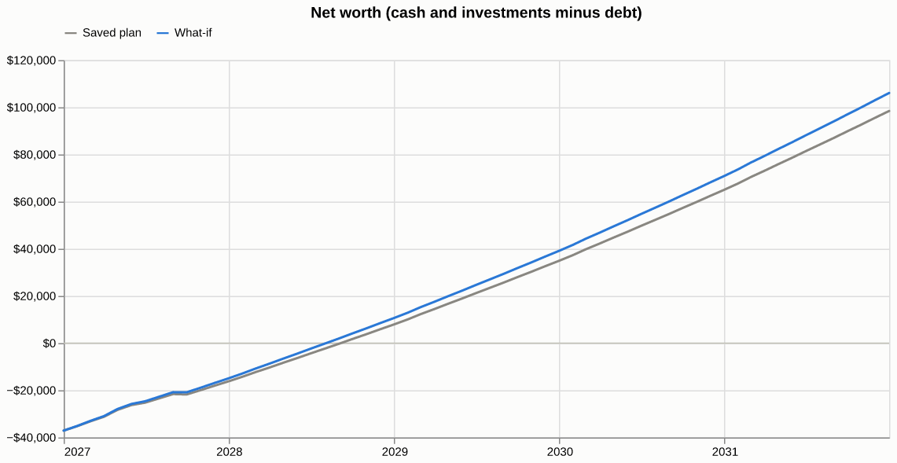

# cashpath

A budget forecast from one YAML plan: month-by-month cash, debts, 401k, Roth, brokerage and net
worth, with debt-free dates and a priority list for leftover money. Python engine, Typer CLI,
Streamlit app with what-if comparison.

**Live demo: [cashpath.streamlit.app](https://cashpath.streamlit.app)** (a made-up plan; upload your own
YAML to try it, nothing is stored)



*The demo plan (grey) against a what-if that raises the 401k from 6% to 12% of salary (blue):
the credit card is paid off a month later, and net worth after five years is $106,065 instead
of $98,441.*

This file is the reference: what exists and how it works. `RUNBOOK.md` is the procedures,
`CLAUDE.md` the agent rules, `TASK.md` the open items.

## What it is

One YAML plan file in; a month-by-month forecast out, as tables in the terminal or as a
Streamlit app with sliders for the what-ifs. The engine is plain Python on exact decimals; the
CLI and the app are thin layers over it. The demo plan belongs to a made-up person. Your own
plan goes in `private/`, which is gitignored.

## Why it exists

A budget spreadsheet answers "where does the money go this month". The questions that matter are
further out: when is each debt gone, how long until the emergency fund is full, what does an
extra 5% to the 401k do to the next five years. cashpath runs the plan forward one month at a time
with real amortization and a fixed order of operations, so every number can be recomputed by
hand, and the app shows what changes when you change one thing.

## Quick start

Needs Python 3.12+ and [uv](https://github.com/astral-sh/uv).

```bash
uv sync
uv run cashpath forecast                     # the demo plan
uv run cashpath forecast private/me.yaml     # your plan
uv run cashpath app private/me.yaml          # the Streamlit app on your plan
```

`private/` is git-ignored. Copy `cashpath/demo.yaml` there and edit it; your numbers never leave
the machine. In the app you can also upload a plan, which is kept in memory only.

```
$ uv run cashpath forecast
cashpath: Sam (demo)   2027-01 to 2031-12

Debt-free dates
┏━━━━━━━━━━━━━━━┳━━━━━━━┳━━━━━━━━━━━━━━━━━━━━━━━━━━━━━┓
┃ debt          ┃   APR ┃                    paid off ┃
┡━━━━━━━━━━━━━━━╇━━━━━━━╇━━━━━━━━━━━━━━━━━━━━━━━━━━━━━┩
│ credit card   │ 23.9% │                     2027-04 │
│ car loan      │  6.9% │                     2030-03 │
│ student loans │  5.0% │ after 2031-12 (10,552 left) │
└───────────────┴───────┴─────────────────────────────┘
Balances
┏━━━━━━━━━━┳━━━━━━━┳━━━━━━━━┳━━━━━━━━┳━━━━━━━━┳━━━━━━━━━━━┳━━━━━━━━━━━┓
┃          ┃  cash ┃   debt ┃   401k ┃   roth ┃ brokerage ┃ net worth ┃
┡━━━━━━━━━━╇━━━━━━━╇━━━━━━━━╇━━━━━━━━╇━━━━━━━━╇━━━━━━━━━━━╇━━━━━━━━━━━┩
│ start    │ 6,000 │ 44,000 │    900 │      0 │         0 │   -37,100 │
│ 3 months │ 2,000 │ 35,785 │  2,545 │      0 │         0 │   -31,240 │
│ 6 months │ 3,713 │ 33,181 │  4,220 │      0 │         0 │   -25,249 │
│ 1 year   │ 6,177 │ 30,066 │  7,657 │      0 │         0 │   -16,231 │
│ 2 years  │ 9,000 │ 23,536 │ 15,036 │  7,401 │         0 │     7,901 │
│ 3 years  │ 9,000 │ 16,585 │ 23,086 │ 15,768 │     3,623 │    34,892 │
│ 5 years  │ 9,000 │ 10,552 │ 41,403 │ 34,471 │    24,120 │    98,441 │
└──────────┴───────┴────────┴────────┴────────┴───────────┴───────────┘
Net worth counts cash and investments minus debt, not cars or homes.

Warnings: none
```

## Commands

All run as `uv run cashpath <command>`. The table is regenerated from `cashpath --help` by the
doc check; edit the help strings in `cashpath/cli.py`, not this table.

<!-- generated:commands start -->
<!-- do not hand-edit: regenerated by doc-check --fix -->
| Command | What it does |
|---|---|
| `cashpath forecast` | Print debt-free dates, balance snapshots and warnings for a plan. |
| `cashpath simulate` | Compare a plan with and without a recurring monthly income or expense change. |
| `cashpath app` | Open the Streamlit app on a plan. Your plan file is read locally and never uploaded. |
<!-- generated:commands end -->

Every command takes a plan file as its argument and uses the demo plan without one.

**simulate.** Runs a plan twice, as written and with one recurring monthly change, and prints
the two side by side. The change is extra income, extra spending, or both, from `--start`
(default: the plan's first month) to `--end` (default: no end). Income is take-home, like every
income row, and gets the annual raise.

```bash
uv run cashpath simulate --income 3000                       # the demo plan
uv run cashpath simulate private/me.yaml --income 3000 --expense 400 --start 2027-03 --end 2027-12
```

```
$ uv run cashpath simulate --income 3000
cashpath: Sam (demo)   2027-01 to 2031-12
Simulation: +$3,000/mo income from 2027-01

Debt-free dates
┏━━━━━━━━━━━━━━━┳━━━━━━━┳━━━━━━━━━━━━━━━━━━━━━━━━━━━━━┳━━━━━━━━━━━━━━━━━━━━━━━━━━━━━┓
┃ debt          ┃   APR ┃                        plan ┃                  simulation ┃
┡━━━━━━━━━━━━━━━╇━━━━━━━╇━━━━━━━━━━━━━━━━━━━━━━━━━━━━━╇━━━━━━━━━━━━━━━━━━━━━━━━━━━━━┩
│ credit card   │ 23.9% │                     2027-04 │                     2027-01 │
│ car loan      │  6.9% │                     2030-03 │                     2030-03 │
│ student loans │  5.0% │ after 2031-12 (10,552 left) │ after 2031-12 (10,552 left) │
└───────────────┴───────┴─────────────────────────────┴─────────────────────────────┘
Net worth
┏━━━━━━━━━━┳━━━━━━━━━┳━━━━━━━━━━━━┳━━━━━━━━━━┓
┃          ┃    plan ┃ simulation ┃   change ┃
┡━━━━━━━━━━╇━━━━━━━━━╇━━━━━━━━━━━━╇━━━━━━━━━━┩
│ start    │ -37,100 │    -37,100 │        0 │
│ 3 months │ -31,240 │    -22,129 │   +9,111 │
│ 6 months │ -25,249 │     -6,963 │  +18,285 │
│ 1 year   │ -16,231 │     20,889 │  +37,121 │
│ 2 years  │   7,901 │     85,607 │  +77,706 │
│ 3 years  │  34,892 │    156,895 │ +122,003 │
│ 5 years  │  98,441 │    321,269 │ +222,828 │
└──────────┴─────────┴────────────┴──────────┘
Net worth counts cash and investments minus debt, not cars or homes.

Warnings (simulation): none
```

The car loan and student loans keep their dates because the demo only prepays debts at 8% APR
or more (`extra_debt_min_apr`); the extra money goes to the emergency fund, Roth and brokerage.

## How it works

### The app

- **Sidebar**: plan source (demo, upload, or the file passed to `cashpath app`), sliders for the
  401k contribution, investment return and annual raise, the cash floor and emergency-fund
  target, and the priority order. Download the what-if as a plan file.
- **Forecast**: debt-free date, net worth at 1 and 5 years with the change against the saved plan,
  net-worth and debt charts, the snapshot table, and payoff dates side by side.
- **Edit plan**: income, expenses, debts and one-time items as editable tables.
- **Month by month**: every month's flows and balances, short months highlighted, CSV download.

The priority order is a multiselect: steps run in the order they were picked; remove one to turn
it off, remove and re-add it to move it to the end.

### The plan file

All rates are percents. Amounts are monthly unless named otherwise.

```yaml
name: Sam (demo)
start: 2027-01
horizon_months: 60

settings:
  investment_return_pct: 7
  cash_yield_pct: 3.5
  annual_raise_pct: 2          # applied to income and salary each January
  cash_floor: 2000             # never spent on priorities
  emergency_fund: 9000         # total cash target, floor included
  roth_annual_limit: 7500
  extra_debt_min_apr: 8        # only debts at or above this APR are prepaid

balances: {cash: 6000, retirement: 900}

retirement:                    # optional pre-tax 401k with an employer match
  gross_salary: 72000
  contribution_pct: 6
  match_pct: 50                # employer adds 50% of what you put in...
  match_up_to_pct: 6           # ...on contributions up to 6% of salary
  marginal_tax_pct: 28         # take-home drops by contribution x (1 - 28%)

income:                        # take-home after tax, before the 401k
  - {name: paycheck, amount: 4400}

expenses:                      # a changed amount is two rows: old with an end, new with a start
  - {name: rent, amount: 1400, end: 2027-05}
  - {name: rent (new place), amount: 1650, start: 2027-06}
  - {name: food, amount: 450}

debts:
  - {name: credit card, balance: 7800, apr: 23.9, payment: 240}
  - {name: car loan, balance: 14200, apr: 6.9, payment: 410}

one_time:                      # + money in, - money out
  - {name: tax refund, month: 2027-04, amount: 900}
  - {name: trip, month: 2027-09, amount: -2000}

priorities: [extra_debt, emergency_fund, roth, brokerage]
```

Unknown fields, months that are not `YYYY-MM`, an end before a start and similar mistakes stop
the run with the field's path, for example `debts.0.apr: Input should be less than or equal to 100`.

### How a month is computed

Always in this order, amounts in exact decimals rounded to the cent:

1. Growth: the 401k, Roth and brokerage earn `investment_return_pct / 12`; positive cash earns
   `cash_yield_pct / 12`.
2. Income: active income rows come in. The 401k contribution comes out at its after-tax cost,
   and the 401k gets the contribution plus the match.
3. Active expenses go out; one-time items for the month go in or out.
4. Each debt accrues `apr / 12` interest, then its payment goes out, capped at what is owed.
5. If cash is negative the month is flagged under Warnings and nothing else happens. Otherwise
   leftover cash goes through `priorities`: a reserve starts at the cash floor;
   `emergency_fund` raises it to the target; `extra_debt` prepays the highest-APR eligible debt;
   `roth` fills this calendar year's limit; `brokerage` takes the rest. Anything left stays cash.

Not modelled: taxes beyond one marginal rate, inflation, vesting schedules, and the value of a
car or home.

## Layout

```
cashpath/
├── plan.py            # the plan: Pydantic models, YAML load and dump
├── units.py           # money, percent and month types
├── engine.py          # the month-by-month forecast
├── state.py           # running balances the engine updates
├── priorities.py      # leftover cash through the priority list
├── report.py          # snapshots, debt-free dates, flat ledger records
├── simulate.py        # a plan with and without one recurring change
├── whatif.py          # a what-if plan from the saved plan plus app edits
├── charts.py          # Altair charts for the app
├── app.py             # the Streamlit app
├── cli.py             # forecast | simulate | app
├── errors.py          # the exception hierarchy
└── demo.yaml          # the demo plan
streamlit_app.py       # Streamlit entrypoint (what the cloud app runs)
tests/                 # engine pins, plan validation, CLI, app smoke test, privacy
assets/                # the README screenshot
private/               # your own plan files; gitignored
```

## Outside the repo

| Thing | Where | Notes |
|---|---|---|
| Live demo | Streamlit Community Cloud, from this repo's `main` | runs `streamlit_app.py`, installs from `uv.lock`; redeploys itself on push |
| Your plan | `private/` in the checkout | gitignored; never committed, never uploaded |

## Development

```bash
uv run ruff check . && uv run ruff format --check . && uv run mypy
uv run pytest
```

Tests pin the engine against hand-checked numbers: a closed-form amortization payoff month, the
last payment capped at balance plus interest, the 401k contribution, match and take-home cost,
the Roth limit resetting each January for a plan that starts mid-year, and the reserve rules. The
app is smoke-tested with Streamlit's `AppTest`. CI runs the same checks, forecasts the demo plan,
then builds the wheel and forecasts from it. Licensed MIT (`LICENSE`).

## Pointers

- `RUNBOOK.md`: run, release, deploy, restore.
- `CLAUDE.md`: the agent rules.
- `TASK.md`: what is open.
- `~/developer/hq/CONVENTIONS.md`: the portfolio release and commit rules.
